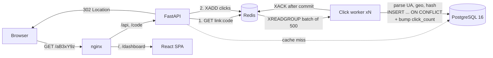

# SnapURL

A URL shortener with real-time click analytics: country, device, browser, OS, referrer and unique visitors. Built with FastAPI, PostgreSQL 16, Redis and React + TypeScript.

The redirect path does one Redis `GET` and one `XADD`. Everything else (user-agent parsing, geolocation, hashing, database writes) happens in a separate worker that batch-writes clicks from a Redis Stream. So analytics never slow a redirect down, and a worker crash never loses or double-counts a click.

## Highlights

- **Fast redirects:** cache-aside link lookup in Redis, with negative caching for unknown codes. A `302` with `no-store` makes every click reach the server, unlike a `301`, which browsers cache.
- **Click pipeline with exactly-once counting:** clicks go into a Redis Stream and are consumed by a consumer group. Delivery is at-least-once (`XACK` comes only after the Postgres commit), but each row is keyed by its stream ID and inserted with `ON CONFLICT DO NOTHING`. `click_count` is incremented in the *same SQL statement* only for rows that were actually inserted, so a redelivered batch is a no-op.
- **Crash recovery:** entries a dead worker read but never ACKed are reclaimed with `XAUTOCLAIM`. You can run any number of workers.
- **Graceful degradation:** if Redis is down, redirects fall back to Postgres and clicks are written directly. Rate limits fail open.
- **Privacy-preserving analytics:** IP addresses are never stored. Unique visitors are counted with `sha256(secret + day + ip + ua)`, a daily-rotating salt, so hashes can't be linked across days. Bots and link previewers are flagged and excluded from the charts.
- **JWT auth with refresh-token rotation:** a 15-minute access token is kept in memory, and the refresh token sits in an `httpOnly`, `SameSite=Strict` cookie, stored hashed. Each refresh rotates the token. **Reusing a rotated token revokes the whole token family** (stolen-token detection). Passwords are hashed with Argon2, and the login flow runs the same hashing work whether or not the account exists, so response timing doesn't reveal which emails are registered.
- **Safe links:** only `http(s)` targets are allowed; `javascript:` URLs and links back to SnapURL itself (which would create loops) are rejected. Random 7-character base62 codes (62⁷ ≈ 3.5 trillion) can't be enumerated, and collisions are caught by the unique index rather than a racy check-then-insert. Custom aliases are validated, with reserved words blocked.
- **Dashboard:** create, search, sort, edit, disable, expire and delete links; QR codes; clicks-over-time charts with a table view; country/referrer/device/browser/OS breakdowns; light and dark themes.

## Architecture



| Concern | Where |
|---|---|
| Redirect + cache | [backend/app/routers/redirect.py](backend/app/routers/redirect.py), [backend/app/cache.py](backend/app/cache.py) |
| Click ingestion (idempotent batch SQL) | [backend/app/clicks.py](backend/app/clicks.py) |
| Stream consumer, reclaim | [backend/app/worker.py](backend/app/worker.py) |
| UA / country / referrer / visitor hash | [backend/app/tracking.py](backend/app/tracking.py) |
| Auth + refresh rotation | [backend/app/routers/auth.py](backend/app/routers/auth.py) |
| Analytics queries | [backend/app/routers/analytics.py](backend/app/routers/analytics.py) |

## Benchmark

k6 against the full Docker Compose stack (nginx → FastAPI with 2 uvicorn workers → Redis), 50 virtual users for 30 s, spread across 20 links. Each request is a real redirect that also enqueues a click.

| Metric | Result |
|---|---|
| Requests | 63,061 redirects, **~2,080 req/s** |
| Latency | median 22.5 ms · **p95 28.9 ms** · p99 34.6 ms |
| Errors | 0 failed requests |
| Click delivery | 63,061 / 63,061 clicks written to Postgres, 0 left pending in the stream |

Machine: laptop, AMD Ryzen 5 5600H, Docker Desktop on Windows (12 vCPU / 8 GB to the VM), load generator on the same machine. These are single-machine numbers, not a production capacity claim. Reproduce with:

```bash
docker run --rm -i --network snapurl_default -e BASE=http://web grafana/k6:0.55.0 run - < loadtest/redirect.js
```

## Run it

```bash
docker compose up -d --build --wait
```

Open http://localhost:8080. The stack includes Postgres, Redis, the API (which runs migrations on start), the click worker and nginx serving the SPA. Scale workers with `docker compose up -d --scale worker=3`.

### Deploy to a small VM

Live at **https://snapurl.duckdns.org**, on an Oracle Cloud Always Free VM (1 vCPU, 1 GB RAM). Caddy issues the HTTPS certificate automatically. The whole stack uses about 215 MB of RAM.

```bash
ssh -i ~/.ssh/key ubuntu@VM_IP 'bash -s' < deploy/setup-vm.sh   # once: swap, Docker, firewall
./deploy/deploy.sh ubuntu@VM_IP your.domain                       # build here, ship images, start
```

Images are built on your machine and streamed to the VM over SSH, so the VM never runs `npm` or `pip`. Secrets are generated on the VM on the first deploy and never leave it. Production refuses to start with a default `JWT_SECRET` or a non-HTTPS `BASE_URL`, and caps links per account (`MAX_LINKS_PER_USER`, default 50) so the public demo can't be used to mass-produce spam links. See [deploy/docker-compose.prod.yml](deploy/docker-compose.prod.yml).

### Local development

```bash
docker compose up -d postgres redis          # Postgres on :55432, Redis on :56379

cd backend
python -m venv .venv && .venv/Scripts/activate   # or: source .venv/bin/activate
pip install -r requirements-dev.txt
alembic upgrade head
uvicorn app.main:app --reload                # API on :8000
python -m app.worker                         # in a second terminal

cd ../frontend
npm install && npm run dev                   # http://localhost:5173 (proxies /api to :8000)
```

### Tests

```bash
cd backend && pytest        # needs the compose Postgres + Redis running
```

The 46 tests run against real Postgres and Redis. They cover the auth flows (including refresh-token reuse detection and rate limiting), link ownership isolation, cache population and invalidation, negative caching, expiry, end-to-end analytics, **redelivered batches counted once**, crashed-consumer reclaim, events for deleted links, and malformed events. CI also checks that the Alembic migrations match the models, then boots the full Docker stack for a smoke test.

## API

Interactive docs: `/docs` on the API.

| Method | Path | |
|---|---|---|
| `POST` | `/api/auth/register` · `/api/auth/login` | Returns an access token and sets the refresh cookie |
| `POST` | `/api/auth/refresh` · `/api/auth/logout` | Rotate or revoke the refresh token |
| `GET` | `/api/auth/me` | Current user |
| `POST` | `/api/links` | `{url, alias?, title?, expires_at?}` |
| `GET` | `/api/links?q=&sort=recent\|clicks&page=` | Search and paginate your links |
| `GET` `PATCH` `DELETE` | `/api/links/{id}` | Edit the target, title, on/off state or expiry |
| `GET` | `/api/links/{id}/stats?days=30` | Timeseries + country/device/browser/OS/referrer breakdowns |
| `GET` | `/api/stats/overview?days=30` | Totals across all your links |
| `GET` | `/{code}` | The redirect |
| `GET` | `/health` | Postgres and Redis status |

## Configuration

Environment variables (see [backend/app/config.py](backend/app/config.py) and [.env.example](.env.example)):

| Variable | Default | Notes |
|---|---|---|
| `BASE_URL` | `http://localhost:8080` (compose) | Origin used in short links |
| `JWT_SECRET` | dev value | **Set this in production.** It also salts the visitor hashes |
| `TRUST_PROXY_HEADERS` | `true` in compose | Read the client IP and `CF-IPCountry`-style headers from the proxy |
| `GEOIP_DB_PATH` | unset | Optional MaxMind GeoLite2 `.mmdb` file for country lookup when there's no CDN header |
| `COOKIE_SECURE` | `false` | Set to `true` behind HTTPS |

Country detection uses a CDN header first (Cloudflare, Vercel, CloudFront), then a GeoLite2 database if one is configured. Without either, country shows as "Unknown".

## Stack

**Backend:** Python 3.12, FastAPI, SQLAlchemy 2 (async) + asyncpg, Alembic, PostgreSQL 16, Redis 7 (cache, Streams, rate limiting), PyJWT, Argon2, user-agents, pytest
**Frontend:** React 18, TypeScript, Vite, Tailwind CSS v4, TanStack Query, Recharts, qrcode.react
**Ops:** Docker Compose, nginx, GitHub Actions, k6

## License

MIT
